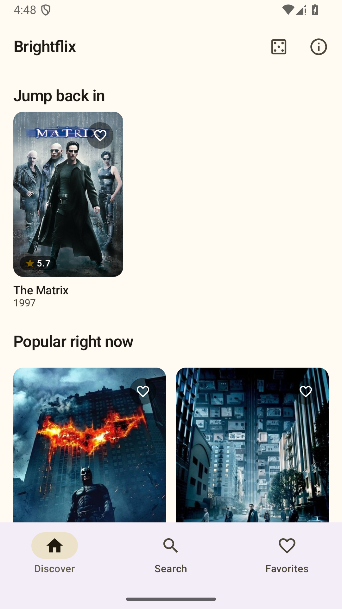
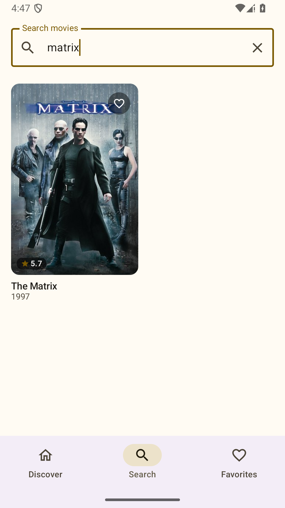
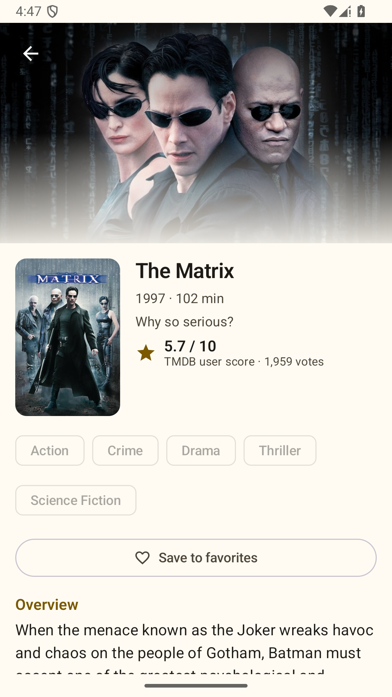
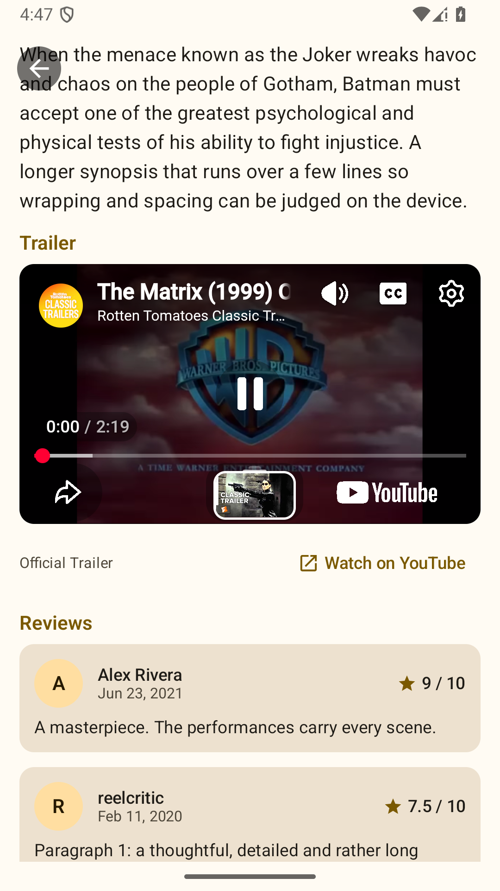
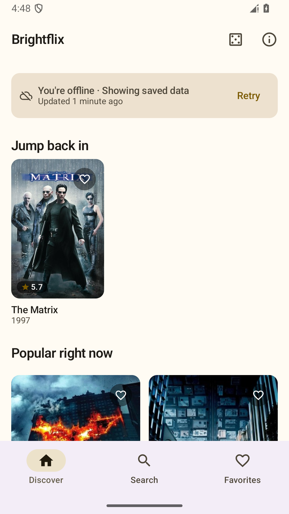

# Alfaflix

Alfaflix is a native Android movie app built with Kotlin and Jetpack Compose on top of the
[TMDB API](https://developer.themoviedb.org/). Open it and you land on a poster grid of what is
popular right now that keeps loading as you scroll. Tap a movie to see its details, what people
wrote about it, and to watch its trailer without leaving the app. Search, favorites and a
"jump back in" history are there too, and anything you have already loaded stays readable
offline.

Built as a submission for the Alfagift Android technical test (**Option Test 1: movies**).

| Discover (endless grid) | Search | Movie detail |
|:---:|:---:|:---:|
|  |  |  |

| Trailer playing in-app, reviews | Offline launch, saved data |
|:---:|:---:|
|  |  |

> **About these screenshots.** They were captured on an Android 15 emulator against a **local
> mock of the TMDB API** serving fixture data (titles, scores and reviews are made up; posters
> and the trailer are real TMDB/YouTube assets). No real TMDB token was available while this was
> built — see [Known issues](#known-issues-and-limitations).

## User stories and where they live

| # | Story | Status | Implementation |
|---|-------|--------|----------------|
| 1 | Main screen: discover movie posters in a grid | Done | [`HomeScreen`](app/src/main/java/com/application/alfaflix/presentation/home/HomeScreen.kt) — `LazyVerticalGrid` fed by TMDB `discover/movie` |
| 2 | Movie tap opens a screen with the primary information | Done | [`MovieDetailScreen`](app/src/main/java/com/application/alfaflix/presentation/detail/MovieDetailScreen.kt) — title, year, runtime, genres, overview, TMDB score |
| 3 | Show user reviews | Done | [`ReviewsSection`](app/src/main/java/com/application/alfaflix/presentation/detail/ReviewsSection.kt) — loading / list / empty / failed-with-retry, expandable long reviews |
| 4 | Show the YouTube trailer | Done | [`TrailerSection`](app/src/main/java/com/application/alfaflix/presentation/detail/TrailerSection.kt) + [`YouTubeTrailerPlayer`](app/src/main/java/com/application/alfaflix/presentation/detail/YouTubeTrailerPlayer.kt); chosen by [`TrailerSelector`](app/src/main/java/com/application/alfaflix/domain/model/Trailer.kt) |
| 5 | Endless scrolling on the main list | Done | [`LoadMoreEffect`](app/src/main/java/com/application/alfaflix/ui/components/PaginatedGrid.kt) → `HomeViewModel.loadNextPage()` → `MovieRepositoryImpl.loadMoreDiscovery()` |
| 6 | Positive and negative cases (internet errors etc.) | Done | Typed [`AppError`](app/src/main/java/com/application/alfaflix/core/result/AppResult.kt), first-load error with retry, inline pagination error with retry, stale-data banner, per-section failure states, missing-token guidance |

Bonus criteria: coroutines and Flow throughout; Room-backed online/offline storage; unit,
Compose UI and on-device tests; MVVM with a clean domain/data split.

## Setup

1. **Get a TMDB API Read Access Token** (free): create an account at
   [themoviedb.org](https://www.themoviedb.org/), then *Settings → API* and copy the
   **API Read Access Token** (the long `eyJ…` value, not the short API key).
2. **Put it in `local.properties`** in the project root (git-ignored):

   ```properties
   TMDB_READ_ACCESS_TOKEN=eyJ...your token...
   ```

   [`local.properties.example`](local.properties.example) shows the format. The environment
   variable `TMDB_READ_ACCESS_TOKEN` works too (handy for CI).
3. **Build and run:**

   ```bash
   ./gradlew assembleDebug        # Windows: gradlew.bat assembleDebug
   ```

The project **compiles and launches without a token**. Live screens then show an actionable
message ("No TMDB access token is configured. Add TMDB_READ_ACCESS_TOKEN to local.properties
and rebuild") instead of a generic failure, and a token TMDB rejects is reported separately.

Requirements: JDK 17, Android SDK 36 (compile/target), device or emulator on Android 7.1+ (API 25).

## Commands

Each of these was run for this submission (results in [Verification](#verification)):

```bash
./gradlew assembleDebug                # debug APK
./gradlew assembleRelease              # R8-minified APK (signed with the debug key unless configured)
./gradlew testDebugUnitTest            # JVM tests: unit, Room (Robolectric), Compose UI
./gradlew lintDebug                    # Android lint
./gradlew connectedDebugAndroidTest    # on-device tests; needs an emulator or device
```

APKs land in `app/build/outputs/apk/{debug,release}/`. Build outputs are not committed.
Release signing: see [Release signing](#release-signing).

## Architecture

MVVM with three layers, wired with Hilt:

```
presentation/   Compose screens + ViewModels (StateFlow UI state)
domain/         models, repository interfaces, use cases with real policy in them
data/           Retrofit + DTOs + mappers, Room + entities, repository implementations
core/           AppResult/AppError, Cached<T>, network monitor, injectable clock
```

Decisions worth knowing about:

- **One identity: the TMDB movie ID.** Navigation, favorites, history and every table key on
  it. IMDb IDs exist only as optional metadata on the detail model. Routes carry just the ID,
  so a screen rebuilds itself from the cache after rotation or process death.
- **Content and refresh state are separate.** Room holds content; an in-memory
  [`RefreshTracker`](app/src/main/java/com/application/alfaflix/data/repository/RefreshTracker.kt)
  holds "is it refreshing / did it fail". The UI combines them, which is what lets a failed
  refresh show a quiet banner over still-usable content instead of an error screen.
- **`RefreshTracker` guarantees:** every tracked operation has a generation, so a cancelled or
  failed operation can never leave a permanent "refreshing" state, and a late-finishing old
  operation can never overwrite a newer one's state. Exclusive mode collapses duplicate
  concurrent requests. Database failures become a failed refresh, never a crash.
- **Reviews and trailer fail independently of the movie.** The detail UI state carries a
  separate state for each section, so a reviews outage never hides the synopsis.
- **Search is not cached; discovery, detail and reviews are.** Typed queries have a near-zero
  hit rate, so persisting them would add complexity for no user benefit.
- **Use cases only where they hold policy:** query length rules, favorite toggling, and
  combining several sources into one consistent stream. There are no pass-through use cases.
- **Image requests are separate from API requests.** Coil uses its own OkHttp client, so the
  API bearer token is never sent to the TMDB image CDN or to YouTube thumbnails.

### Pagination strategy

Discovery uses TMDB's paginated `discover/movie` (sorted by popularity, 20 per page, capped at
500 pages by TMDB). I kept and adapted the project's custom pagination rather than adopting
Paging 3: the list is already persisted page by page in Room, needs explicit page bookkeeping,
and its refresh/retry/dedup semantics are specific, so a `RemoteMediator` would have added a
second abstraction over logic that was already written and tested. The trade-off is that a bit
more logic lives in this project instead of a library.

- Pages append inside one transaction (`DiscoveryDao.appendPage`) together with the page
  bookkeeping, so the list and its metadata cannot disagree.
- Each refresh starts a new **epoch**. A page response that raced a refresh carries the old
  epoch and is discarded — a page 2 fetched before a refresh can never be appended to the
  refreshed list.
- Concurrent "load next page" calls issue a single request; repeated movies across pages are
  dropped by the primary key; the last page is `loadedPages >= min(total_pages, 500)`.
- After an inline failure the grid stops auto-loading and waits for the user's Retry, instead
  of hammering a broken endpoint on every frame.
- Scroll state is remembered per back-stack entry, and the banner and history row share one
  always-present grid item, so returning from a movie lands on the same position even after
  the history row appears above.

### Offline scope

| Works offline | Needs a connection |
|---|---|
| Previously loaded discovery pages (persisted in Room) | First-ever launch (shows an honest offline error with Retry) |
| Previously opened movie details and their reviews | Search |
| Favorites and "jump back in" history (device-local) | Trailer playback (YouTube) |
| Posters already in Coil's disk cache (best effort, not guaranteed) | Refreshing anything |

Freshness windows: discovery 1 h, detail 1 day, reviews 6 h; pull-to-refresh and Retry bypass
them. When connectivity returns after a failed load, Home retries on its own. Failed refreshes
never touch stored content.

### Favorites migration (database v1 → v2)

The previous version identified movies by IMDb ID (OMDb). This app has not shipped, but the
favorites are user data, so they are preserved rather than dropped:
[`Migrations.MIGRATION_1_2`](app/src/main/java/com/application/alfaflix/data/local/database/Migrations.kt)
parks each old favorite in `legacy_favorites`; on the next online launch
[`LegacyFavoritesMigrator`](app/src/main/java/com/application/alfaflix/data/repository/LegacyFavoritesMigrator.kt)
resolves the IMDb ID through TMDB's `find` endpoint and moves it into `favorites`, keeping the
original order. It is resumable and idempotent. OMDb-era caches and view history are dropped
(they are rebuilt from TMDB). The migration is covered by tests on the JVM and on a device.

### Credentials

`TMDB_READ_ACCESS_TOKEN` is read from git-ignored `local.properties` or the environment into
`BuildConfig` and sent as a bearer header. The `Authorization` header is redacted from logs and
response bodies are never logged. **Being accurate about what this achieves:** `BuildConfig`
keeps the token out of version control but not out of the APK; anyone can extract it from a
built artifact. Real protection needs a backend proxy holding the token, which is out of scope
for a client-only assignment.

Debug builds additionally accept an optional `TMDB_BASE_URL` (and allow cleartext HTTP to
`10.0.2.2`/`localhost`, debug only) so the app can be pointed at a local mock server. Release
builds always use `https://api.themoviedb.org/3/`.

### Trailers

The trailer is chosen deterministically from TMDB's video list: YouTube videos of type
`Trailer` only (a teaser is never labelled a trailer), official before unofficial, then most
recently published, then by key. It plays through YouTube's IFrame Player API (hosted in a
WebView by [android-youtube-player](https://github.com/PierfrancescoSoffritti/android-youtube-player))
and only starts when the user taps play. If YouTube refuses the embed, the screen says so and
offers **Watch on YouTube**, which opens the YouTube app or browser. Offline, tapping play
explains that a connection is needed. Video files are never cached.

## Verification

Toolchain: AGP 8.13.2, Gradle 8.13, Kotlin 2.3.20, compileSdk 36, JDK 17. (Hilt 2.59+ and the newest
androidx/Compose require AGP 9, so this project pins the last versions that build with AGP 8.)

Results on 2026-09-30 (Windows 11), after the project was moved from `brightflix` to `alfaflix`:

| Check | Result |
|---|---|
| `assembleDebug` | passed |
| `testDebugUnitTest` | 208 tests, all passed |
| `assembleRelease` | **not re-run after the move** — the disk filled up. It passed before the move, on the `brightflix` copy |
| `lintDebug` | **not re-run after the move** for the same reason. It passed before the move, ahead of a few later UI edits |
| `connectedDebugAndroidTest` | **not re-run after the move.** 5 tests passed on an Android 15 emulator before it |

Please re-run `lintDebug`, `assembleRelease` and `connectedDebugAndroidTest` on your machine.

Manual checks on the emulator against a local mock TMDB server (debug build, and a minified
debug build to exercise R8): online first launch; endless scrolling through three pages with
exactly one request per page; network failure during pagination showing the inline retry and
recovering; offline relaunch with cached discovery, history, detail and reviews;
first-ever launch offline followed by automatic recovery when connectivity returned; a failing
trailer lookup with the movie still readable; a movie with no reviews and one with no trailer;
returning from a movie to the same scroll position; search; rotation; and 1.8× font scale.

**Not verified:** anything against the real TMDB service (see below); dark theme; TalkBack.

### What the tests cover

- Discovery pagination, retry, termination and duplicate prevention; concurrent load-more;
  page-after-refresh discard; TTL behaviour; failed refresh with a warm cache; cancelled
  refresh cleanup; database failure during refresh (`MovieRepositoryTest`, `RefreshTrackerTest`)
- Stale search responses and immediate invalidation, including A → B → A, retry and pagination
  races, and query restoration (`SearchViewModelTest`)
- DTO mapping and missing data (`TmdbMappersTest`); HTTP/transport error mapping and
  cancellation (`MovieRemoteDataSourceTest`); trailer selection (`TrailerSelectorTest`)
- Independent detail/reviews/trailer states (`MovieDetailViewModelTest`)
- Favorites through the identity migration (`MigrationTest`, `LegacyFavoritesMigratorTest`,
  on-device `FavoritesPersistenceTest`)
- Critical journey through real ViewModels and real Compose UI: Home grid → detail → reviews
  (expand/collapse) → trailer (play, then playback failure and fallback) → favorite →
  Favorites (`CriticalJourneyTest`); empty, error and partial-failure states (`ScreenStatesTest`)

The YouTube WebView cannot run on the JVM, so the UI tests substitute a stand-in player
through a composition local; the real player was exercised on the emulator.

## Known issues and limitations

- **No live TMDB verification.** No real token was available in the build environment, so the
  endpoints, parameters and DTOs follow TMDB's documentation and were exercised against a mock
  that mimics it. First thing to do with a real token: run the app once and open a few movies.
- **TMDB logo not included.** TMDB's terms ask for their logo *and* a notice; the About screen
  carries the required notice text, but the logo asset is not bundled. Add it before any public
  release.
- **Reviews show TMDB's first page only** (up to 20); there is no review pagination.
- **Embedded playback has limits.** Some videos disallow embedding (handled with the YouTube
  fallback); rotating the device restarts a playing video.
- **Search results are not cached**, by design.
- **Legacy favorites need a network and a TMDB match** to migrate; titles TMDB cannot resolve
  are dropped.
- **Tablet/landscape layouts are functional, not tailored** (the detail backdrop is capped in
  landscape; the grid is adaptive).
- **Accessibility** is handled by construction (labelled controls, touch targets, heading
  semantics, no colour-only state) but has not been audited with TalkBack.
- The floating back button can overlap scrolled detail text.

## Release signing

Release builds are signed with the **debug keystore by default**, so `assembleRelease` always
produces an installable APK without committing a keystore. To sign with a real key, add to
`local.properties`: `RELEASE_STORE_FILE`, `RELEASE_STORE_PASSWORD`, `RELEASE_KEY_ALIAS`,
`RELEASE_KEY_PASSWORD`.

## Credits

This application uses TMDB and the TMDB APIs but is not endorsed, certified, or otherwise
approved by TMDB. (The same notice is shown in the app under **About**.) Trailers are played
through YouTube's embedded player. Movie data and images: [TMDB](https://www.themoviedb.org/).

Earlier planning documents ([`alfaflix-design.md`](alfaflix-design.md),
[`alfaflix-plan.md`](alfaflix-plan.md)) describe the previous OMDb-based version and are
kept for history only.
